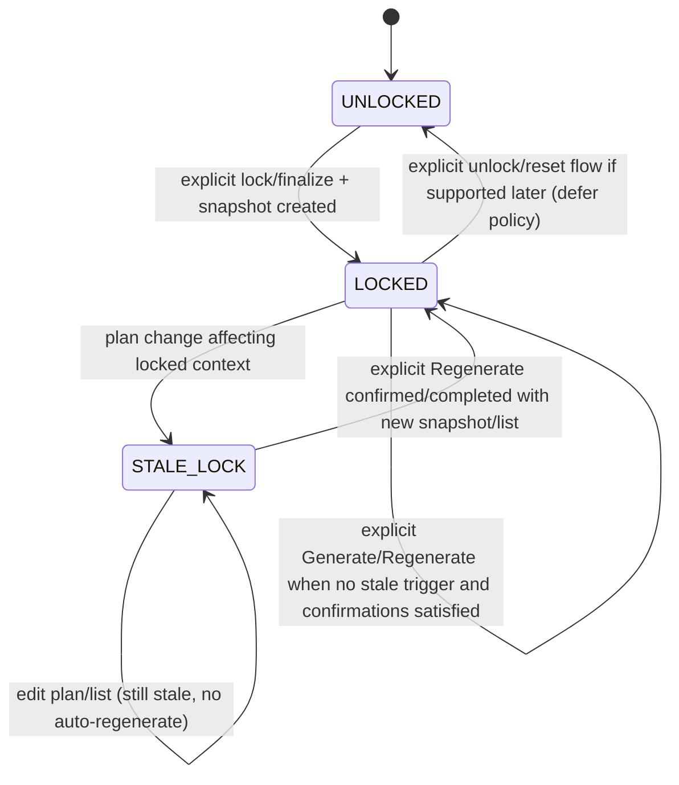
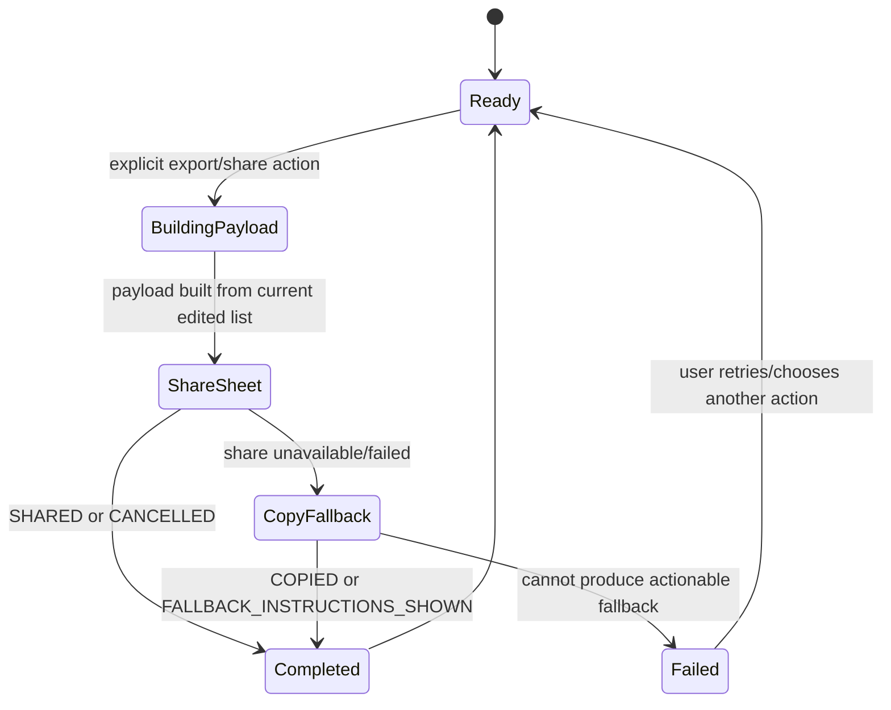
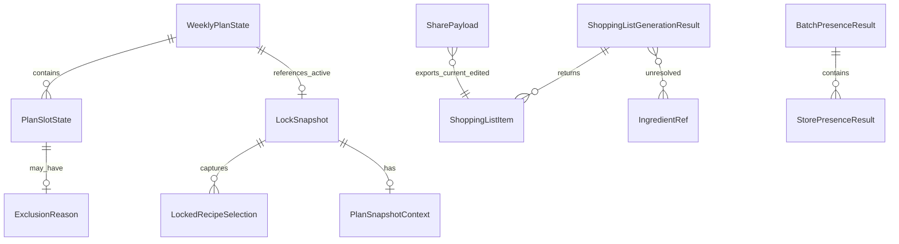

# U1 Functional Design — Functional Specification (`u1-mvp-foundation-skeleton`)

**Intent:** `261107-weekly-meal-planner` (scope `mvp`)  
**Unit:** U1 — MVP foundation + integration slice  
**Stage:** Functional Design (construction, per-unit)  
**Date:** 2026-11-08

## 1. Purpose and scope
U1 establishes the Android MVP foundation and integration slice: baseline contracts, local-first state boundaries, explicit fallback/error typing, and core workflow skeletons for C1–C6. U2 completes recipe/plan/store logic; U3 completes grocery aggregation, presence projection orchestration, and export seam; U4 owns presentation. U1 must make dependent Construction safe by defining minimum baseline shapes (R-01, Q1=A) and explicit defers.

### In scope for U1 baseline
- C1 baseline: 7-day plan state model, slot identity, lock/stale visibility, Today/Plan continuity metadata.
- C2 baseline DTOs for recipe/ingredient access used by C1/C4, with source/fallback status and weekday-time exclusion data hooks (AC2.2.3).
- C3 baseline DTOs for season context/override/effective resolution.
- C4 baseline: lock snapshot (ADR-006), explicit generate/regenerate request/result, stale warning semantics, ingredient re-resolution contract, merge baseline, and C4-owned `ApplyBatchPresenceToList` contract.
- C5 baseline: store ref/selection and best-effort name/presence batch result contracts; C5-owned `MapIngredientsToStorePresenceBatch` contract.
- C6 baseline: mandatory share-sheet/copy-text fallback payload/result and simple in-app share/copy boundary; extraction seam deferred to U3 (R-03, Q3=B/Q7=A).
- A1–A3 baseline: typed status/source/fallback/reason shapes.
- Logical local persistence baseline (Q4=A): plan state, lock snapshot context, shopping list + edits, selected store, season override, source/fallback/status metadata.

### Out of scope / deferred
- Full recipe catalog ranking, Sydänmerkki live query implementation details, and complete season suggestion behavior (U2).
- Full grocery aggregation UX, PRISMA adapter implementation, and presence orchestration implementation (U3; C5 lookup logic details).
- Extraction seam interfaces/port implementation (`ExportShoppingListUseCase`/equivalent, `ShoppingExportPayload`, `ShoppingExportAdapter` platform port, official-compatible S-ostoslista adapter) — **U3 Functional Design owner** (Q7=A).
- UI composition, screens, and presentation copy/layout (U4).
- Storage technology selection (Room/DataStore/files/etc.) — NFR Design/Code Generation.

## 2. Upstream alignment
- **Unit/story map:** U1 participates partially in many stories as foundation/baseline (US1.1, US1.2, US2.1–US2.5, US3.1–US3.3, US4.1–US4.2, US5.1–US5.6). U1 does not claim full UI completion; it provides contracts/state/workflow baselines U2–U4 complete.
- **ADR-006/R-01–R-03:** implemented as C4/C1 baseline contracts and rules BR1.6–BR1.9.
- **FR3 / US2.2 AC2.2.3 ownership:** U1/U2 own explanation data/contracts; U4 owns presentation. U1 defines minimum weekday-time exclusion fields in candidate/plan results (`ExclusionReason`: `reasonCode`, `messageKeyOrTextSource`, slot ref, recipe/candidate ref, `sourceMarker`) per Q5=B/Q8=A. U2 may generalize to reusable `ExclusionOrWarningReason`.
- **R-02 (Q2=C/Q6=A):** explicit split — C5 `MapIngredientsToStorePresenceBatch`; C4 `ApplyBatchPresenceToList`; U3 orchestrates; unknown-after-edit/merge-regenerate remains C4-owned.

## 3. Key workflows

### 3.1 Plan initialization and slot baseline (US1.1, FR1, FR11)
1. Load persisted `WeeklyPlanState` if available; otherwise create empty 7-day structure with required slots (BR1.1).
2. For each required slot, set `EMPTY` unless persisted assignment exists.
3. Attach `DataSourceStatus`/continuity metadata where available.
4. Expose state to C1/U4 consumers; unfilled slots remain empty and visible.

### 3.2 Weekday eligibility evaluation hook (US2.2, FR2, FR3, AC2.2.3)
1. C2 baseline provides recipe/candidate time metadata when known.
2. For Mon–Fri slot assignment/suggestion consideration:
   - total prep+cooking <= 30 min => eligible (subject to other filters owned by U2).
   - > 30 min => ineligible with `ExclusionReason.reasonCode=WEEKDAY_TIME_OVER_30`.
   - missing/ambiguous => ineligible with `WEEKDAY_TIME_AMBIGUOUS`.
3. U1 baseline includes exclusion fields in results; U4 renders explanation later.

### 3.3 Lock snapshot, generate, and regenerate (US3.1, US3.2, FR9, ADR-006)
1. **Lock/finalize (explicit):** capture `LockSnapshot` with locked recipe IDs/selections + `PlanSnapshotContext` (BR1.6). No ingredient freeze.
2. **Generate (explicit):** require locked/finalized context and snapshot ref. C4 re-resolves ingredients from C2 for locked recipe IDs (BR1.8), applies merge baseline (BR1.10), returns `ShoppingListGenerationResult`.
3. **Plan change after lock:** mark `STALE_LOCK`, set exact stale warning text (BR1.9). Do not auto-regenerate.
4. **Regenerate (explicit):** if list has user edits, request confirmation (`NEEDS_CONFIRMATION` or equivalent precondition) before replacing. On confirmed regenerate, re-resolve from C2 using current lock/snapshot context rules; missing/changed data explicit.

#### State machine — lock/list lifecycle

### 3.4 Batch presence projection/remap (US4.2, FR8, R-02)
1. **C5 `MapIngredientsToStorePresenceBatch`:** minimum input `MapIngredientsToStorePresenceBatchRequest` (`ingredientRefs` optional, `queryItems` required, `storeRef` required, `lookupContext` optional); minimum output `MapIngredientsToStorePresenceBatchResult` wrapping `BatchPresenceResult` (`PRESENT|NOT_FOUND|UNKNOWN` per item with `A2` reasons). Name/presence only.
2. **C4 `ApplyBatchPresenceToList`:** minimum input `ApplyBatchPresenceToListRequest` (`items` required, mapped `projections` required, `storeRef` required, optional `shoppingListId`/`mappingContext`); minimum output `ApplyBatchPresenceToListResult` (updated items, `APPLIED|PARTIAL|FAILED`, optional `unknownOrRemapCount`/fallback reason). Unresolved mapping becomes `UNKNOWN` with reason.
3. **U3 orchestration (deferred implementation):** calls C5 then C4. After user edits/merge/regenerate, C4 applies unknown-after-edit/merge-regenerate/remap rules; no fabricated presence.
4. C4 never performs PRISMA lookup; C5 never owns merge/stale semantics (BR1.12). Remap identity baseline: match by `ingredientRef` when stable, else normalized `queryText`/`displayName` mapping key with explicit ambiguity -> `UNKNOWN`.

### 3.5 Share/copy fallback export (US4.1, FR10, R-03)
1. Build `SharePayload` from **current edited shopping list** (BR1.11).
2. Attempt Android share sheet through simple C6 in-app boundary; if unavailable/fails, offer copy-text and/or manual instructions.
3. Return typed `ShareResult` (`SHARED|COPIED|CANCELLED|FAILED|FALLBACK_INSTRUCTIONS_SHOWN`).
4. **Deferred to U3 Functional Design:** extraction seam `ExportShoppingListUseCase`/equivalent, `ShoppingExportPayload`, `ShoppingExportAdapter`/platform share port, dependencies inward, official-compatible S-ostoslista adapter behind same port (Q7=A).

#### State machine — export/share fallback

## 4. Derived views

### 4.1 Entity relationship (logical)

### 4.2 Rule coverage focus
| Area | Rules | Primary refs |
|---|---|---|
| Schedule/time/exclusion | BR1.1, BR1.2 | FR1–FR3, US1.1, US2.2 AC2.2.3 |
| Source/fallback/nutrition/privacy baseline | BR1.3, BR1.4, BR1.13, BR1.14 | FR4–FR6, FR11–FR12, NFR1,NFR4,NFR5 |
| PRISMA presence boundary | BR1.5, BR1.12 | FR7, FR8, US4.2 |
| Lock/snapshot/generate/regenerate/stale | BR1.6–BR1.10 | FR9, US3.1, US3.2, ADR-006/R-01–R-03 |
| Export fallback | BR1.11 | FR10, US3.3, US4.1 |

## 5. Contract and defer register
| Contract/area | U1 action | Owner/defer |
|---|---|---|
| C1 baseline | Define minimum state/slot/lock visibility shapes | U1; U2 extends |
| C2/C3 baselines | Define minimum DTOs/status hooks used by U1/C4 | U1 baseline; U2 completes |
| C4 snapshot/generation baseline | Define ADR-006 snapshot/result types, merge baseline, `ApplyBatchPresenceToList` | U1/C4 baseline; U3 completes aggregation/orchestration |
| C5 presence baseline | Define `StorePresenceResult`/batch and `MapIngredientsToStorePresenceBatch` | U1/C5 baseline; U2/U3 complete lookup/orchestration |
| C6 fallback boundary | Define `SharePayload`/`ShareResult` and simple share/copy boundary | U1 baseline; **U3 FD owns extraction seam** (Q7=A) |
| A1–A3 | Define minimum typed reason/status shapes | U1 baseline; U2/U3 extend |

## 6. Risks and notes
- Greenfield Android project has no runtime code yet; these are logical contracts for Construction stages.
- U2/U3 must preserve ADR-006 stale warning exact text and R-02/R-03 semantics.
- Any contract break across units follows coordinated migration (contract summary 5.2).
