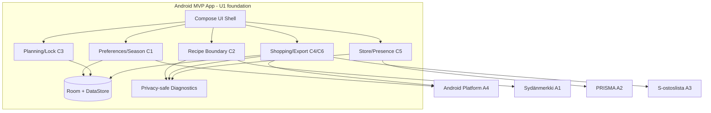

# Logical Components — U1 `u1-mvp-foundation-skeleton`

**Intent:** `261107-weekly-meal-planner` (scope `mvp`)  
**Unit:** U1 — MVP foundation + integration slice (Android app)  
**Stage:** NFR Design (construction, per-unit)  
**Date:** 2026-11-08

## Upstream
- [tech-stack-decisions.md](../nfr-requirements/tech-stack-decisions.md)
- [functional-spec.md](../functional-design/functional-spec.md), [entities.md](../functional-design/entities.md)
- [contract-summary.md](../../../inception/contract-design/contract-summary.md)
- [nfr-design-questions.md](nfr-design-questions.md) (Q1=A, Q2=A)

## Component inventory (logical)

| Component | Responsibility | Failure domain / isolation | NFR patterns |
|---|---|---|---|
| UI Shell (Compose) | Renders plan/list states, explicit fallback/unknown/stale labels, next actions; collects user intent. | UI errors must not corrupt persisted domain state; render from typed state. | Explicit state observability, responsive local updates. |
| Planning Domain (C1/C3 baseline) | Weekly plan slots, lock snapshot context, stale status, Today/Plan continuity metadata. | Isolated from network; operates on local state/contracts. | ADR-006 semantics, local continuity. |
| Recipe Domain Boundary (C2 baseline) | Recipe/ingredient query contracts, eligibility/exclusion data hooks, source status. | Adapter failures mapped to typed fallback/unavailable; no fabrication. | Bounded adapter calls, graceful degradation. |
| Shopping/Export Domain (C4/C6 baseline) | Generate/regenerate from lock snapshot + C2 re-resolution, edit state, share/copy fallback payload/result. | Generation uses explicit actions only; export fallback independent of S-ostoslista official path. | No auto-regeneration, mandatory fallback. |
| Store/Presence Boundary (C5 baseline) | Store selection refs, presence query/result contracts; name/presence only. | PRISMA failures become `UNKNOWN`/manual checklist; never stock/guarantee. | Typed fallback, bounded calls (U3). |
| Preferences/Privacy (C1) | Season override/default/reset, permission/privacy state, selected settings metadata. | Optional location; app usable without it. | Data minimization, purpose-limited permission. |
| Local Persistence | Room for structured entities; DataStore/preferences for small settings. App-private storage. | I/O failures mapped to explicit error/recovery state; no sensitive logs. | Local continuity, minimal data. |
| Adapter Layer (A1–A3, U2/U3 implementation) | Outbound integrations behind interfaces; timeout/fallback mapping. | Each adapter isolated; failure cannot block local core flows. | Bounded timeout, safe retries for idempotent reads only. |
| Platform Abstractions (A4) | Permissions, share sheet/clipboard, date/location signals. | Permission denial/unavailable handled as normal state. | Graceful degradation. |
| Diagnostics (lightweight) | Privacy-safe local diagnostic events/integration point. | Must never contain prohibited personal data. | Minimal observability. |

## Boundaries and blast radius
- **Core local blast radius:** UI rendering, local persistence corruption/validation, and domain state transitions (C1/C3/C4). Mitigated by typed states, explicit save/load behavior, and no fabrication.
- **External integration blast radius:** A1/A2/A3 failures. Contained by adapter isolation + bounded timeout + typed fallback/manual paths.
- **Privacy blast radius:** location/diagnostics/persistence. Contained by permission scoping, data minimization, privacy-safe logging policy.

## Component diagram (logical)

## Notes
- U1 is foundation/integration slice, not a deployable backend service (ADR-001, R-02).
- Module/package boundaries are refined in Code Generation; contracts remain the authoritative integration surface.
