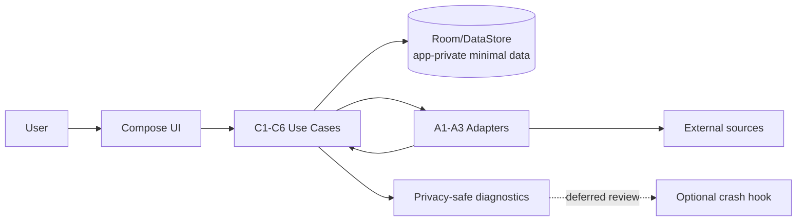

# Security Design — U1 `u1-mvp-foundation-skeleton`

**Intent:** `261107-weekly-meal-planner` (scope `mvp`)  
**Unit:** U1 — MVP foundation + integration slice (Android app)  
**Stage:** NFR Design (construction, per-unit)  
**Date:** 2026-11-08

## Upstream
- [security-requirements.md](../nfr-requirements/security-requirements.md) (local `NFR4.1`–`NFR4.5`, `NFR5.1`; maps to inception NFR3 primary)
- [functional-spec.md](../functional-design/functional-spec.md), [rules.md](../functional-design/rules.md)
- [contract-summary.md](../../../inception/contract-design/contract-summary.md) (A1–A4, FR11/FR12)
- [nfr-design-questions.md](nfr-design-questions.md) (Q2=A, Q4=A, Q5=A)

## Design goals
- No MealPlanner account/auth in MVP.
- Data minimization and purpose-limited location.
- No hardcoded secrets; privacy-safe diagnostics.
- Nutrition/health-related information view-only and non-medical.

## Patterns and decisions

| Area | Design | Addresses | Notes |
|---|---|---|---|
| Authentication/account scope | No login, no account identifiers, no remote user profile in MVP. | NFR4.1 | Future sync/account out of scope. |
| Data minimization | Persist only: weekly plan state, ADR-006 lock snapshot context (IDs/selections+plan context), shopping list + checked/edited items, selected store, season override, source/fallback/status metadata. | NFR4.2, ADR-006 | No ingredient freeze in snapshot; no unnecessary personal data. |
| Location privacy | Request location permission only when user invokes nearest-store suggestion (or equivalent). If denied/unavailable, use manual store selection and explicit state. No continuous/background tracking in MVP. | NFR4.3 | Purpose text required in UI implementation (U4). |
| Secrets/configuration | No secrets, API keys, credentials, or private endpoints in source control. Any future adapter config uses externalized/build-time injection with review. | NFR4.4 | U1 baseline avoids embedded secrets. |
| Privacy-safe diagnostics | Structured local diagnostic events contain only privacy-safe fields (event type, component/contract, result status, non-sensitive error category, timestamps/durations as needed). Prohibit coordinates, precise/raw location, raw personal identifiers, recipe/user free-text payloads unless explicitly sanitized and justified. | NFR4.5, NFR4.6 | User-visible fallback states preferred over verbose logs. |
| Optional crash reporting hook | Integration point may be added later; disabled/deferred until privacy review confirms data minimization and no prohibited fields. | NFR4.5 | Not required for MVP. |
| Local storage protection | Use Android platform storage defaults in app-private storage. Stronger encryption-at-rest for all local state is deferred (not selected in Q4). | NFR4.2 | Reassess if sensitive data scope expands. |
| Medical scope boundary | Nutrition information displayed only when available; missing data labeled `Nutrition information unavailable`. No diagnoses, treatment recommendations, or personalized medical dosing. | NFR5.1, BR1.14 | View-only cues only. |
| Untrusted integration boundaries | Treat Sydänmerkki/PRISMA/S-ostoslista/platform inputs as untrusted: validate/map to typed results, never execute untrusted instructions, never fabricate data. | FR11, BR1.13 | Explicit fallback/unknown states required. |

## Data flow (privacy-minimized)

## Deferred
- Explicit local-data deletion UX (Q4=B not selected).
- Encryption-at-rest for all local state beyond platform defaults.
- Formal DPIA/legal review (outside engineering artifact).
- Crash reporting SDK/vendor choice and privacy configuration.
