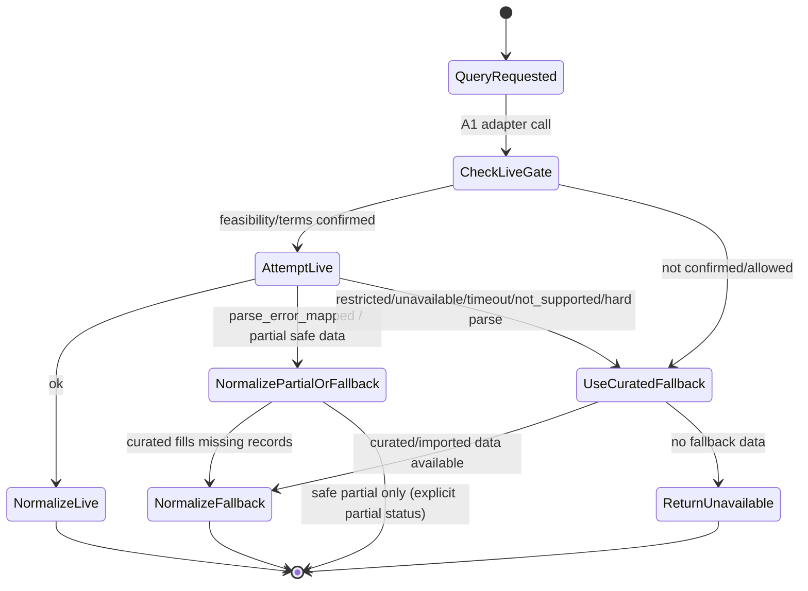
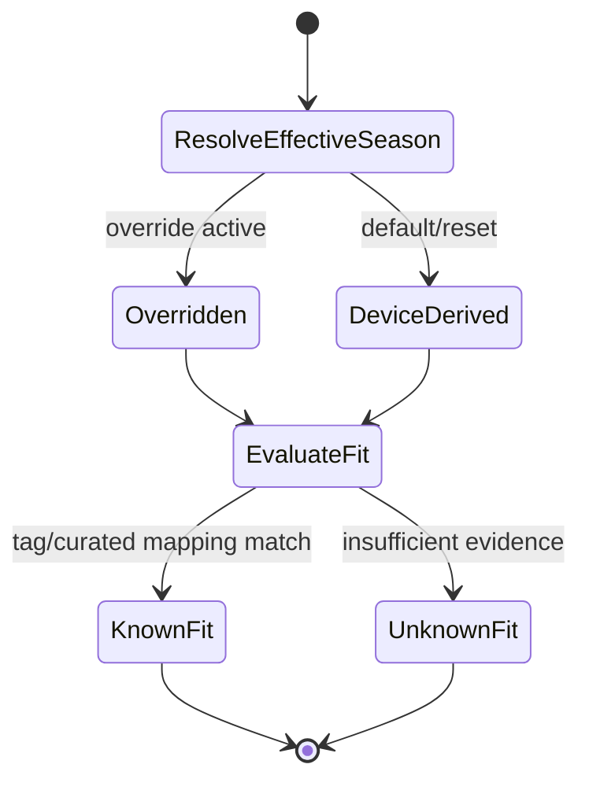
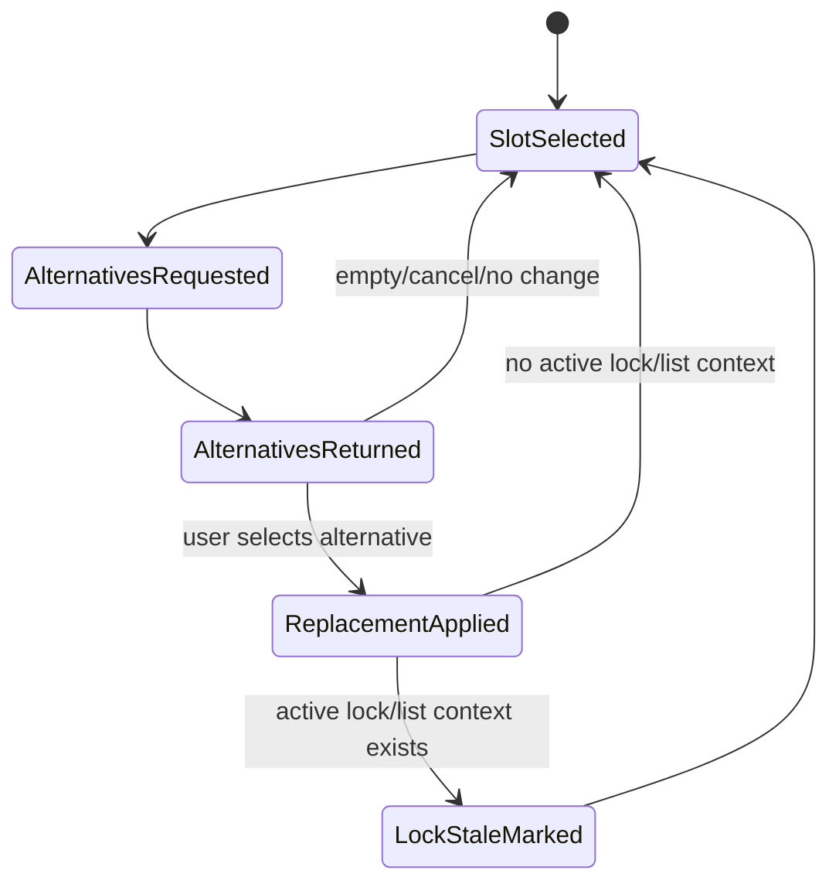
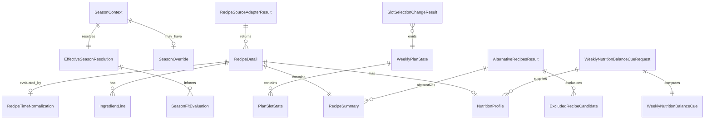

# U2 Functional Design — Functional Specification (`u2-recipe-planning-completion`)

**Intent:** `261107-weekly-meal-planner` (scope `mvp`)  
**Unit:** U2 — Recipe + planning completion (`library`)  
**Stage:** Functional Design (construction, per-unit)  
**Date:** 2026-11-09

## 1. Purpose and scope
U2 completes recipe/catalog and meal-planning domain capabilities on top of U1 contracts and skeleton. It owns C2/C3 completion behavior: Sydänmerkki adapter boundary/investigation hooks and source/fallback status (FR4, OQ1/FQ1=A), full recipe metadata normalization (time verifiability, season tags/fit including `Season fit unknown`, nutrition cues/labels/minimal planning-aid data, ingredient entries/preparation notes), alternatives/replacement contracts, and robust Today/Plan synchronized state contracts (R-06). U4 owns presentation; U1 baselines and ADR-006 invariants remain authoritative.

### In scope
- C2 completion: `RecipeSourceAdapter`/A1 port usage, recipe normalization, weekday eligibility normalization (FR3/OQ7), alternatives (`getAlternatives`), season fit evaluation (FR5/OQ5), nutrition cues + minimal weekly balance cue (FR6/OQ6), source/fallback status.
- C3 completion: per-slot selection/replacement/clear operations affecting only target slot, single source of truth for Today/Plan, observable plan state updates, stale-lock signaling on slot changes (BR1.9/ADR-006).
- Typed fallback/unknown/partial states for recipe/planning flows.

### Out of scope
- UI composition/copy/layout beyond contract labels/fields required by rules (U4).
- PRISMA presence lookup implementation/projection (U3), shopping-list merge/edit/export completion (U3).
- Scraping or terms-violating Sydänmerkki access; live execution only when feasibility/terms/allowed access confirmed (FQ1=A).
- Medical nutrition targets/dosing/diagnosis/treatment.

## 2. Upstream alignment
- **U2 unit/story map:** partial implementation for US1.1, US1.2, US2.1–US2.5, US5.4–US5.6 (with U1/U4 as mapped). U2 provides domain contracts/data; U4 presents.
- **Canonical slot type:** `PlanSlotRef` (U1 ENT-U1-001, C1 baseline) is used consistently in U2; U2 does not define `MealSlotRef`.
- **Shared/baseline type sources:** U2 reuses U1 baseline/contract-summary types (e.g., `PlanSlotRef`, `RecipeSummary`, `IngredientLine`, `SeasonContext`, `EffectiveSeasonResolution`, `WeeklyPlanState`, `RecipeSourceStatus`, `ExclusionReason`). `RecipeFilters` is minimally defined in U2 `entities.md` for C2 query contracts and may be extended additively.
- **AC2.2.3 ownership:** U1/U2 own weekday exclusion/explanation data (`RecipeTimeNormalization`, `ExclusionReason`, candidate exclusion records). U4 presents the user-visible explanation.
- **AC2.3.4:** C2/C3 support explicit season override/default/reset and effective resolution; U4 may expose controls.
- **ADR-005:** thin orchestration in UI; business rules in domain contracts.
- **ADR-006/BR1.9:** slot/plan changes affecting locked context mark stale with exact warning semantics; no auto-regeneration.

## 3. Key workflows (authoritative)

### 3.1 Recipe source resolution (Sydänmerkki + curated fallback) — FR4, US2.5, US5.4
1. C2 receives a recipe query (`CATALOG|BY_ID|BY_IDS|ALTERNATIVES|ELIGIBILITY`) with slot/season/filter context (`PlanSlotRef` context when slot-specific).
2. C2 invokes A1 adapter with `allowLiveSource=true` only when OQ1 feasibility/terms/allowed access are confirmed for the requested path.
3. Adapter behavior:
   - **Live path confirmed/allowed:** attempt bounded live query; map result to typed status (`ok`, `fallback_used`, `unavailable`, `restricted`, `timeout`, `parse_error_mapped`, `not_supported`) and `investigationOutcome`.
   - **Live path not confirmed/allowed:** do not execute live query; return `restricted`/`unavailable`/`not_supported` as appropriate and set `investigationOutcome` `not_feasible_or_allowed` or `unknown`.
   - **`parse_error_mapped` / partial safe data:** if live data is partially parseable and safe, adapter may return normalized partial records only when fields are explicitly marked and records remain usable without fabrication; it must attempt curated/imported fallback to fill missing records where possible. If fallback contributes, return `fallback_used` with clear `RecipeSourceStatus`/`fallbackReason`; if only safe partial live data is returned, return `parse_error_mapped` with explicit partial status and `partialDataUsable` as applicable. Hard parse failure or unusable live result is a typed failure and must use curated fallback if available, else explicit unavailable.
4. On any non-usable live result, adapter uses **mandatory curated/imported Sydänmerkki-aligned fallback** when available and returns `fallback_used` with `RecipeSourceStatus`.
5. C2 normalizes results into `RecipeDetail`/`RecipeSummary`/`RecipeCandidateResult`; missing fields remain explicit. Every result carries source/fallback status.

### 3.2 Recipe normalization and eligibility for slot context — FR2, FR3, AC2.1.*, AC2.2.*
1. Input: source recipe payload or curated record.
2. Normalize identity/title, ingredients (`IngredientLine` baseline), preparation/cooking guidance, season tags, and nutrition attributes when reliably available.
3. Compute `RecipeTimeNormalization`:
   - Parse confidently => `KNOWN` + `totalTimeMinutes`.
   - Missing source time => `MISSING`.
   - Ranges/conflicts/unit confusion/unparseable => `AMBIGUOUS` (no guessing).
4. For Mon–Fri `BREAKFAST|DINNER` slot contexts: eligible only when `KNOWN` and `totalTimeMinutes <= 30`.
5. For ineligible weekday candidates, attach `ExclusionReason` (`WEEKDAY_TIME_OVER_30` or `WEEKDAY_TIME_AMBIGUOUS`) with slot/candidate refs and source marker.
6. Return normalized detail/summary plus `dataCompleteness`, `sourceStatus`, and exclusion data; recipe remains viewable unless an explicit non-selection rule applies to a specific operation.

### 3.3 Season fit evaluation and override — FR5, AC2.3.*
1. C3 resolves `EffectiveSeasonResolution` from `SeasonContext` + `SeasonOverride`:
   - `DEFAULT` => device date + optional coarse location hint/area context.
   - `OVERRIDE` => override takes precedence until reset.
   - `RESET`/no override => default resolution.
2. C2 evaluates `SeasonFitEvaluation` for each recipe using recipe `seasonTags` or curated mapping table.
3. If mapping evidence is insufficient, return `SEASON_FIT_UNKNOWN` with explanation key (never fabricate match).
4. Expose `effectiveSeasonResolution` and `seasonFitLabel` to selection/alternatives/filtering consumers and UI contracts.

### 3.4 Nutrition cues and minimal weekly balance cue — FR6, AC2.4.*, BR1.14
1. C2 builds `NutritionProfile` from reliably available attributes only for recipe detail/summary contexts; set `nutritionAvailability` `AVAILABLE|PARTIAL|UNAVAILABLE`.
2. Missing nutrition data uses contract label `Nutrition information unavailable` (or equivalent explicit unavailable state) and does not block viewing/selection.
3. **Ownership/boundary for weekly cue:** C3 remains authoritative for selected slot/recipe state (R-06/BR2.7). C2 must not read `WeeklyPlanState` directly. The C3/U4 orchestration boundary assembles `WeeklyNutritionBalanceCueRequest` (selected recipe IDs and/or resolved `nutritionProfilesByRecipeId`) from current C3 plan state and C2 recipe nutrition data as needed.
4. C2 computes `WeeklyNutritionBalanceCue` only from supplied `WeeklyNutritionBalanceCueRequest` inputs:
   - include only recipes/attributes with available data;
   - produce simple counts/averages/tag counts;
   - report `excludedFromCalculationCount` and clear explanation key;
   - missing profiles count as excluded/unavailable.
5. Cue is view-only and non-medical; no targets/dosing/diagnosis/treatment.

### 3.5 Alternatives and replacement — US1.2, AC1.2.*
1. UI/U4 requests alternatives via C2 `getAlternatives` with `AlternativeRecipesRequest` (slot, current recipe, effective season, fallback source allowance).
2. C2 returns candidates respecting:
   - weekday time eligibility for the slot (BR2.3),
   - season fit context (BR2.4),
   - source/fallback status (BR2.1).
3. Result may be `EMPTY|FALLBACK|UNAVAILABLE` with explicit reason and excluded-candidate data.
4. On user replacement, C3 applies `SlotSelectionChangeRequest` to the target slot only, updates `WeeklyPlanState` (single source of truth), and emits `SlotSelectionChangeResult`.
5. If an active lock/list snapshot context exists, C3/C1 state marks stale per BR1.9/ADR-006; exact downstream stale warning remains: `Meal plan modified. Grocery list not up-to-date. Press the Regenerate button.` No auto-regeneration.

### 3.6 Today/Plan synchronization — R-06, AC1.1.3, AC1.2.3
1. `WeeklyPlanState` slot selections are the only authoritative selection state.
2. Any applied slot operation emits updated `WeeklyPlanState` and changed slot ref.
3. Today and Plan consumers observe the same state/contracts; downstream grocery/list consumers use current selected recipes and stale status, never stale slot copies.

## 4. Derived views

### 4.1 Entity relationship (logical, derived from entities.md)

### 4.2 Rules summary (derived from rules.md)
| Rule | Focus | Key refs |
|---|---|---|
| BR2.1 | Sydänmerkki adapter path, gated live execution, mandatory curated fallback | FR4, US2.5, US5.4, FQ1=A |
| BR2.2 | Safe recipe normalization / partial data | FR2, US2.1 |
| BR2.3 | Weekday time normalization without guessing; AC2.2.3 data | FR3, US2.2, BR1.2 |
| BR2.4 | Season fit, unknown, override precedence | FR5, US2.3, AC2.3.4 |
| BR2.5 | Nutrition cues and minimal non-medical weekly balance cue (C2 computes from C3/U4-supplied request; C2 does not read plan state) | FR6, US2.4, BR1.14 |
| BR2.6 | Alternatives respect eligibility/season/fallback | US1.2, FR2–FR5 |
| BR2.7 | Single Today/Plan source of truth; per-slot changes | R-06, US1.1, US1.2 |
| BR2.8 | Slot changes mark lock stale; no auto-regeneration | ADR-006, BR1.9, FR9 |
| BR2.9 | Local/fallback reliability and privacy-safe behavior | FR11, FR12, NFR2/3/5 |

## 5. Contract notes and defers
| Area | U2 provides | Deferred owner |
|---|---|---|
| C2 completion | Normalization, eligibility/time, source adapter port usage, alternatives, season fit, nutrition cue/planning-aid contracts | U3 uses re-resolution/generation integration; U4 presents |
| C3 completion | Slot selection/replacement/clear semantics, Today/Plan single-source observable state, stale-lock signaling on slot changes | U4 full UX/navigation; U1/U3 ADR-006 generation/export behavior |
| A1 | Typed adapter outcomes, investigation outcome, curated fallback mandatory; live execution gated by confirmed feasibility/terms | Implementation feasibility closure (OQ1) |
| UI | Required contract labels/fields only (`Nutrition information unavailable`, `Season fit unknown`, ExclusionReason fields) | U4 presentation/copy/layout |

## 6. Risks / open questions carried forward
- **OQ1:** Sydänmerkki live access method/terms/fields remain investigational; FQ1=A requires gated live execution and mandatory curated fallback.
- **OQ5:** Finland curated season mapping detail/granularity refined during implementation; contract keeps `SEASON_FIT_UNKNOWN` safe.
- **OQ6:** Exact reliably available nutrition attributes depend on confirmed Sydänmerkki/fallback data; optional-field model remains additive.
- **OQ7:** Real recipe time text formats may vary; normalization must not guess ambiguous cases.