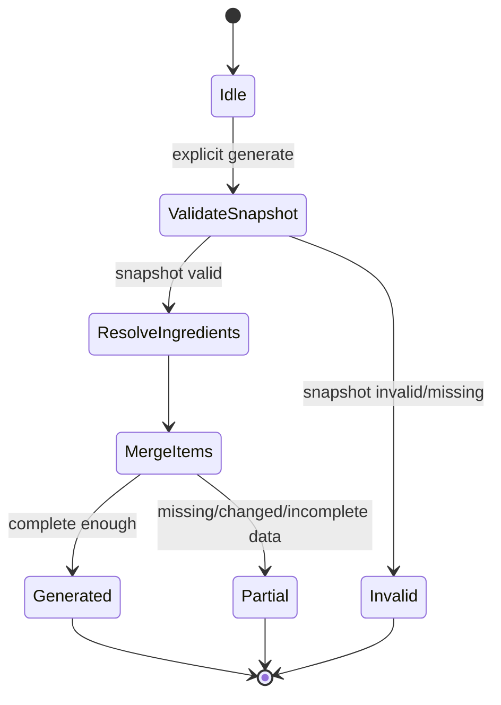
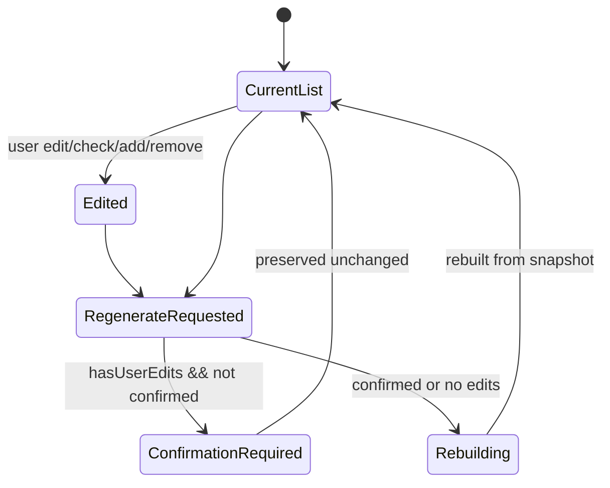
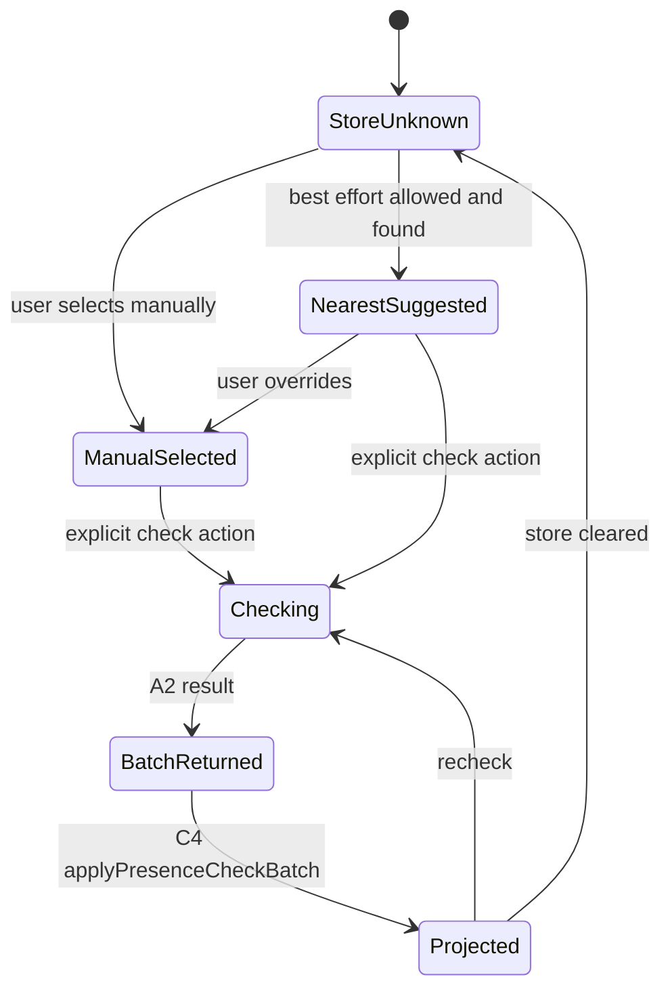
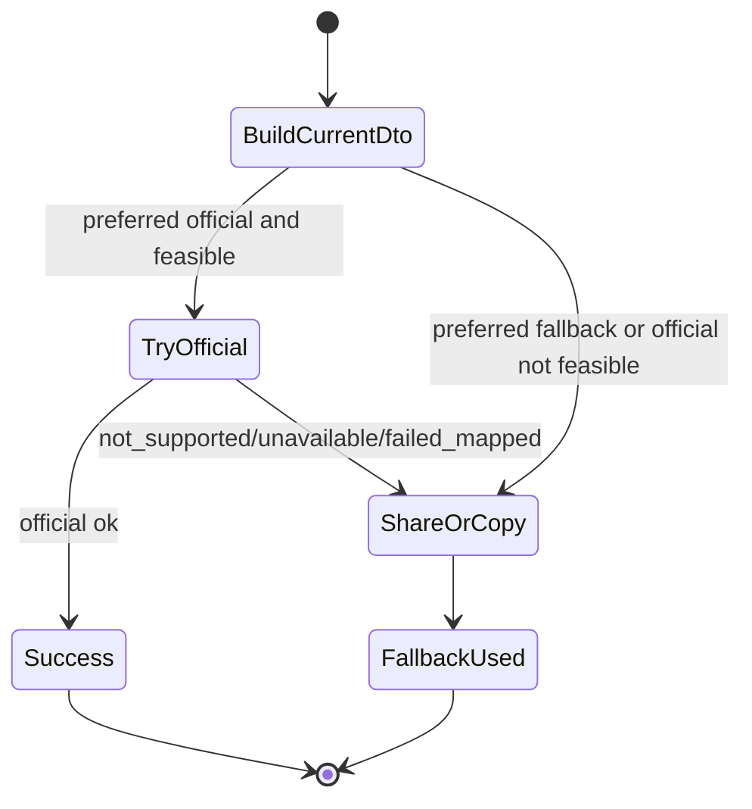
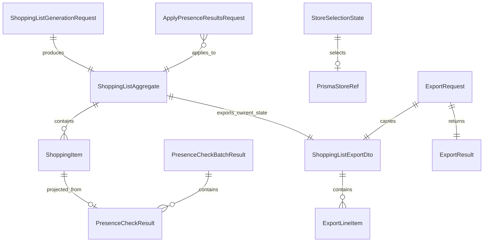

# U3 Functional Design — Functional Specification (`u3-grocery-store-export-completion`)

**Intent:** `261107-weekly-meal-planner` (scope `mvp`)  
**Unit:** U3 — Grocery + store + export completion (`library`)  
**Stage:** Functional Design (construction, per-unit)  
**Date:** 2026-11-09

## 1. Purpose and scope
U3 completes grocery, store/availability, and export domain capabilities on top of U1 baselines and C2/C3 contracts. It owns C4 completion (locked-snapshot generation, re-resolve, deterministic merge, edit/check/add/remove, regeneration confirmation, stale signaling, availability projection), C5 completion (PRISMA store selection and best-effort name/presence checks, never stock/guaranteed availability), and C6 completion (S-ostoslista official attempt boundary + mandatory share/copy fallback) with a stable grocery/export extraction seam. U4 owns presentation; ShoppingList owns availability projection (ADR-006/R-02).

### In scope
- C4: `generateFromLock`/`regenerate`, ingredient re-resolution from C2 by locked IDs (ADR-006/R-01), merge, list edits, explicit `applyPresenceCheckBatch`/availability projection, stale warning semantics (exact text preserved), export of current edited list.
- C5/A2: manual store selection always, nearest-store suggestion best effort when permitted, batch name/presence checks with `PRESENT|NOT_FOUND|UNKNOWN` + reason.
- C6/A3 + seam: export use-case interface, `ShoppingListExportDto` payload, platform/share adapter port; Android share sheet/copyable text mandatory fallback with instructions; S-ostoslista official attempt investigational (OQ4).
- Typed fallback/unknown/partial/unavailable states; no fabrication.

### Out of scope
- UI composition/copy/layout/navigation beyond contract fields/statuses (U4).
- Recipe normalization/season/nutrition/slot selection business rules (U1/U2).
- Live PRISMA/S-ostoslista network implementations when not feasible/confirmed (OQ2–OQ4); adapters return typed not-supported/unavailable/fallback outcomes.
- Backend/public API; account/sync; stock quantity or guaranteed availability claims.

## 2. Upstream alignment
- **Unit/story map:** U3 owns US3.1–US3.3, US4.1–US4.2, and partial US5.2–US5.3/US5.4 integration behavior (with U1/U4 as mapped).
- **ADR-006/R-01–R-03:** snapshot IDs+context only; re-resolve ingredients at generation; ShoppingList owns availability projection/remap; stale warning exact: `Meal plan modified. Grocery list not up-to-date. Press the Regenerate button.`; no auto-regeneration.
- **R-02:** StoreAvailability returns raw/batch presence results keyed by item/query context; C4 applies/remaps.
- **Project corrections:** define explicit C4 apply-batch/remap/Unknown-after-edit-merge-regenerate behavior (BR3.5); define minimum stable grocery/export extraction seam (BR3.9).
- **OQ2–OQ4:** PRISMA/S-ostoslista feasibility investigational; contracts degrade safely with mandatory fallbacks.

## 3. Key workflows (authoritative)

### 3.1 Generate shopping list from locked snapshot — FR9, US3.1, ADR-006
1. U4/C3 boundary requests `generateFromLock` with `snapshotId` from explicit user action (R-03).
2. C4 loads `LockedRecipeSnapshot` (IDs/selections + plan context). If invalid/missing, return `INVALID_SNAPSHOT`.
3. C4 re-resolves recipe details/ingredient lines from C2 for `lockedRecipeIds` (`getRecipesByIds`/equivalent). Missing/changed recipes produce explicit `missingOrChangedRecipeIds` and `INCOMPLETE`/`MISSING_SOURCE` notes; no fabrication.
4. C4 normalizes ingredient candidates and merges deterministically (BR3.2): normalized name + compatible unit/amount => merged line with provenance; incompatible/uncertain => separate lines with `MergeDecision` reason.
5. C4 creates `ShoppingListAggregate` with `hasUserEdits=false`, `listStatus=GENERATED|PARTIAL`, `availabilityStatus=NOT_CHECKED` (or `UNKNOWN` where context absent) and clear reasons for incomplete data.
6. C4 observes/records current stale status from C3/lock context; if already stale, surface `ShoppingListStaleStatus` (exact warning text preserved) but do not auto-regenerate.

### 3.2 Edit list and regenerate with confirmation — FR9, US3.2
1. C4 applies `ShoppingItemPatch` operations: check/uncheck, edit text/quantity, add manual item, remove item. Each mutating user action sets `hasUserEdits=true` and `lastEditedAt`.
2. On edit/merge/split/add/remove that changes identity/query context, C4 applies BR3.5 remap: keep availability only when identity clearly unchanged; else set `UNKNOWN`/`NOT_CHECKED` with `availabilityReason` until rechecked.
3. On `regenerate` request:
   - if `hasUserEdits` and `confirmRegenerateIfEdited` is not true, return `CONFIRMATION_REQUIRED` and preserve current edited list unchanged.
   - if confirmed (or no edits), rebuild from current locked snapshot per 3.1, clear edit markers as appropriate for rebuilt list, reapply BR3.5 (default `NOT_CHECKED`/`UNKNOWN` unless explicit safe remap policy applies).
4. C4 never auto-regenerates after plan changes.

### 3.3 Stale list signaling — ADR-006/R-03, US3.2
1. C3/U2 slot changes or plan changes affecting locked context emit stale indicators.
2. C4 marks/reflects `ShoppingListStaleStatus.isStale=true` with exact warning:
   `Meal plan modified. Grocery list not up-to-date. Press the Regenerate button.`
3. Stale status does not modify item text automatically and does not trigger regeneration.
4. User can continue editing/exporting current list (with stale warning visible via U4).

### 3.4 Store selection and PRISMA presence check — FR7, FR8, US3.3, US5.2, US5.3
1. U4 requests nearest-store suggestion via C5/A2 only when location permission/purpose context allows; C5 returns best-effort suggestion or typed unavailable/denied/unknown.
2. User can always select store manually (`selectStoreManually`); manual selection updates `StoreSelectionState`.
3. For presence checks, C4/U4 builds `PresenceCheckQuery` items from current list item refs/query names (normalized best effort). C5/A2 checks selected store by name/presence only.
4. A2 returns `PresenceCheckBatchResult` with per-item `PRESENT|NOT_FOUND|UNKNOWN` and reasons; batch may be `PARTIAL`/`UNAVAILABLE`/`DENIED`/`FAILED_MAPPED`.
5. C4 applies results via explicit `applyPresenceCheckBatch` (BR3.5): match by stable item/query key and store/scope; update only matched items; preserve unrelated edits; ambiguous/unmatched post-change items become `UNKNOWN` with reason.
6. UI may show manual checklist regardless of result (U4).

### 3.5 Export current edited list (S-ostoslista attempt + mandatory fallback) — FR10, US4.1, US4.2
1. U4 requests export through export use-case interface with preferred method and `ShoppingListExportDto` built from **current** `ShoppingListAggregate` (current checked/edited/added/removed state).
2. Export seam: domain/use-case creates DTO and calls platform/share adapter port (inward dependencies only).
3. If preferred method is `S_OSTOSLISTA_OFFICIAL_IF_AVAILABLE` and A3/OQ4 path is feasible/confirmed, adapter may attempt official export with bounded mapped outcome.
4. On `ok` with official method, return `SUCCESS`/method used. On `not_supported|unavailable|failed_mapped|partial/unconfirmed`, use mandatory fallback: Android share sheet and/or copyable text with clear instructions; return `FALLBACK_USED` with instructions and investigation outcome.
5. Fallback is always available even when official attempt is never made.

## 4. Derived views

### 4.1 Entity relationships (derived from entities.md)

### 4.2 Rules summary (derived from rules.md)
| Rule | Focus | Key refs |
|---|---|---|
| BR3.1 | Locked snapshot generation, re-resolve ingredients, no fabrication | FR9, ADR-006/R-01, US3.1 |
| BR3.2 | Deterministic merge; separate incompatible/uncertain | FR9, US3.1 |
| BR3.3 | Edits/check/add/remove; regeneration confirmation; export current edited list | FR9, FR10, US3.2, US4.1 |
| BR3.4 | Exact stale warning, no auto-regeneration | FR9, ADR-006/R-03, US3.2 |
| BR3.5 | ShoppingList owns availability projection; explicit `applyPresenceCheckBatch`; remap/Unknown after edit/merge/regenerate | FR8, ADR-006/R-02, US3.3 |
| BR3.6 | Nearest PRISMA best effort; manual store always available | FR7, FR12, US3.3, US5.2 |
| BR3.7 | Name/presence only; never stock/guaranteed availability; `UNKNOWN` with reason | FR8, NFR2, US3.3 |
| BR3.8 | Current edited export; S-ostoslista attempt behind adapter; mandatory share/copy fallback + instructions | FR10, OQ4, US4.1, US4.2 |
| BR3.9 | Stable grocery/export extraction seam (use-case interface, DTO, platform/share port) | project learning, Q1 direction |
| BR3.10 | Typed reliability/privacy-safe behavior, no fabrication | FR11, FR12, NFR2, NFR3, NFR5 |

## 5. Contract notes and defers
| Area | U3 provides | Deferred owner |
|---|---|---|
| C4 completion | Generation/re-resolve/merge/edit, confirmation, stale handling, availability projection, explicit apply-batch/remap, export DTO construction | U4 presents Grocery UX/RM-05/RM-06/RM-07 and confirmations |
| C5 completion | Store selection contracts, PRISMA presence batch contracts, best-effort/Unknown semantics | A2 implementation details depend on OQ2/OQ3; U4 permission/store-selection UX |
| C6 completion | Export use-case interface/DTO/port contracts, official-attempt + mandatory share/copy fallback semantics | A3 official method depends on OQ4; U4 Android intents/share sheet UI |
| C2/C3 | Consumes locked snapshot and recipe re-resolution/batch-by-ID; respects stale signaling and R-06 | U1/U2 own those contracts |

## 6. Risks / open questions carried forward
- **OQ2/OQ3:** PRISMA store-location and ingredient/presence data quality/matching remain investigational; contracts require `UNKNOWN`/manual fallback and never stock/guarantee claims.
- **OQ4:** S-ostoslista official method/format/terms unknown; fallback share/copy + instructions mandatory.
- Merge normalization (units/aliases) may be imperfect in MVP; BR3.2 requires safe "separate with reason" over unsafe merges.
- Presence remap across complex edits can be ambiguous; BR3.5 defaults to `UNKNOWN`/`NOT_CHECKED` rather than stale confidence.
- Android platform adapter details (share intents, clipboard, permission flows) belong to Infrastructure/Code Generation/U4 integration but seam contracts must remain stable.