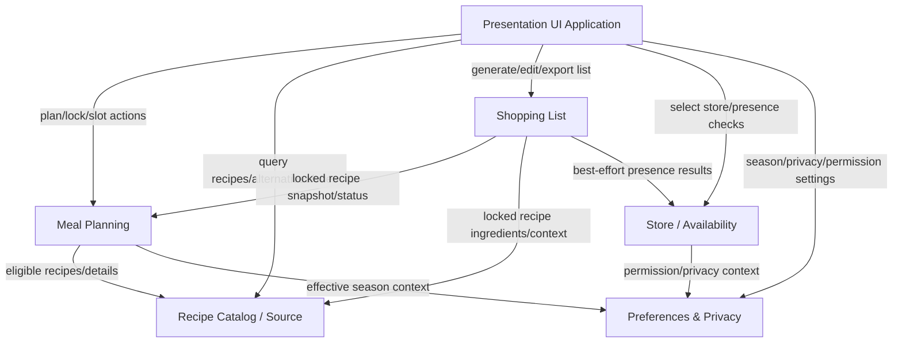

# Component Catalogue — Weekly Meal Planner (Android MVP)

**Intent:** `261107-weekly-meal-planner` (scope `mvp`, space `default`)  
**Stage:** Domain Design (inception)  
**Date:** 2026-11-08  
**Boundary (Q1=A):** Android app primary MVP boundary. Backend/service, if introduced, is treated as an external dependency/integration boundary (see ADR-001). Components are logical building blocks (code we write), not deployment topology.

## Sources
- [requirements.md](../requirements-analysis/requirements.md) (FR1–FR12, NFR1–NFR5)
- [stories.md](../user-stories/stories.md) (US1.1–US5.6)
- [refined mockups](../refined-mockups/mockups.md), [interaction-spec](../refined-mockups/interaction-spec.md)
- [team-practices.md](../practices-discovery/team-practices.md)
- [domain-design-questions.md](domain-design-questions.md) (Q1=A,Q2=A,Q3=B,Q4=A,Q5=A,Q6=A, summary confirmed `Looks correct`)

## Part A — Machine-Readable Catalogue

```yaml
components:
  - name: PresentationUiComponent
    summary: Android presentation layer orchestrating Today/Plan/Grocery/User flows and delegating domain logic to feature components.
    behaviour: >
      Implements screen flows and navigation from refined mockups (RM-01–RM-09, Q3=B full-screen replacement/store selection),
      keeps Today and Plan synchronized from shared slot selections (R-06), leaves unfilled slots empty, presents loading/empty/error/fallback states,
      routes user actions to domain components, displays explicit status labels (Nutrition information unavailable, Season fit unknown, Unknown + reason),
      requests/reflects location permission with purpose text, and triggers export/share via Android platform while preserving current edited list state.
      Contains no business-rule ownership beyond UI state orchestration; R-03 lock/generate rules, FR3 eligibility, and FR9 merge rules are owned by domain components and invoked via thin UI-facing contracts.
    responsibilities:
      - Render and navigate Today, Plan, Grocery, User and full-screen flows
      - Collect user input (slot selection, lock action trigger, generate/regenerate, edits, export) and invoke domain operations
      - Present domain results, fallback states, permission/status messages, and accessibility semantics
    depends_on:
      - component: MealPlanningComponent
        interaction: read/update weekly plan slots, lock/finalize recipes, and receive slot-change status
        style: sync
      - component: RecipeCatalogComponent
        interaction: query eligible recipes/alternatives and retrieve recipe details/cues
        style: sync
      - component: ShoppingListComponent
        interaction: generate/regenerate from locked snapshot, edit/check items, and export current edited list
        style: sync
      - component: StoreAvailabilityComponent
        interaction: select/suggest PRISMA store and request best-effort ingredient presence checks
        style: sync
      - component: PreferencesPrivacyComponent
        interaction: read/update season context, permission/privacy UI state, and local preference settings
        style: sync
    dependents: []
    external_dependencies:
      - name: Android UI framework / Material 3
        kind: other
        purpose: render Material 3 screens, navigation, accessibility, and responsive layouts
      - name: Android system settings / permission prompts
        kind: other
        purpose: display location permission purpose and open/manage permission settings
      - name: Android share sheet / clipboard
        kind: other
        purpose: provide S-ostoslista fallback export (share/copy) when official method unavailable
    entities: []

  - name: MealPlanningComponent
    summary: Owns the 7-day plan structure, slot selections, replacement, and recipe-lock snapshot for shopping generation.
    behaviour: >
      Enforces FR1 slot structure (Mon–Fri Breakfast/Dinner; Sat–Sun Breakfast/Lunch/Dinner), maintains a single source of truth for slot selections shared by Today/Plan,
      allows per-slot selection/replacement without changing other slots (R-06), leaves slots empty until selected, coordinates eligibility queries with RecipeCatalogComponent
      using current season context from PreferencesPrivacyComponent, and produces LockedRecipeSnapshot only when user explicitly locks/finalizes recipes (R-03).
      LockedRecipeSnapshot captures the locked recipe selections/IDs and plan context (not a frozen copy of ingredient data). ShoppingListComponent re-resolves ingredient entries from RecipeCatalogComponent for locked recipes at generation time.
      When the plan changes after a snapshot used by the current shopping list, MealPlanning exposes stale status so UI/Shopping List can warn "Meal plan modified. Grocery list not up-to-date. Press the Regenerate button." No auto-regeneration.
      Does not generate shopping lists or perform external integration I/O.
    responsibilities:
      - Manage weekly plan and meal-slot lifecycle
      - Apply slot-specific replacement/selection and preserve other selections
      - Lock/finalize selected recipes into an immutable snapshot for explicit shopping-list generation
      - Expose plan/lock status to Grocery flow
    depends_on:
      - component: RecipeCatalogComponent
        interaction: obtain eligible recipe candidates/details for slots and replacements
        style: sync
      - component: PreferencesPrivacyComponent
        interaction: obtain effective season context (device default or user override) for eligibility/display context
        style: sync
    dependents:
      - component: PresentationUiComponent
        interaction: UI reads/updates plan and lock state
      - component: ShoppingListComponent
        interaction: generate shopping list only from locked recipe snapshot
    external_dependencies:
      - name: Android local persistence
        kind: database
        purpose: persist weekly plan, slot selections, and locked snapshot on-device for MVP
    entities:
      - name: WeeklyPlan
        identifier: weeklyPlanId
        attributes: [weekStartDate, dayPlans, status, sourceOfTruthScope]
      - name: MealSlot
        identifier: mealSlotId
        attributes: [dayOfWeek, mealType, selectedRecipeId, slotState]
      - name: LockedRecipeSnapshot
        identifier: snapshotId
        attributes: [createdAt, lockedRecipeSelections, lockedRecipeIds, planContext, staleIndicator]

  - name: RecipeCatalogComponent
    summary: Owns recipe/source data, normalization, and eligibility/filtering for meal planning and selection.
    behaviour: >
      Attempts Sydänmerkki-based recipe support via adapter boundary and falls back to curated/imported Sydänmerkki-aligned catalog when live data is unavailable/restricted/fails (FR4).
      Normalizes recipe metadata needed by MVP (title, ingredients, total prep/cooking time, season tags/cues, nutrition cues/attributes, source/fallback status),
      enforces weekday total-time eligibility (Mon–Fri Breakfast/Dinner <= 30 minutes; missing/ambiguous excluded with explanation) (FR2/FR3),
      computes season-fit labels including Season fit unknown (FR5), provides nutrition cues/labels and minimal planning-aid data from reliably available attributes (FR6),
      and returns explicit unavailable/fallback statuses without fabricating missing data.
    responsibilities:
      - Provide recipe details and source/fallback status
      - Filter eligible recipes for slot/day/weekday time and current season context
      - Normalize and expose nutrition/season/time metadata with safe unavailable labels
      - Supply ingredients for locked-snapshot shopping-list generation
    depends_on: []
    dependents:
      - component: PresentationUiComponent
        interaction: UI queries recipes/details/alternatives and planning cues
      - component: MealPlanningComponent
        interaction: planning requests eligible recipes and recipe details for slots
      - component: ShoppingListComponent
        interaction: list generation reads ingredient data for locked recipes
    external_dependencies:
      - name: Sydänmerkki source (sydanmerkki.fi)
        kind: third-party-api
        purpose: investigate and use live Sydänmerkki recipe data when feasible/allowed
      - name: Curated/imported Sydänmerkki-aligned recipe catalog
        kind: other
        purpose: fallback recipe data when live source is unavailable/restricted/fails
      - name: Android local persistence/cache
        kind: database
        purpose: cache previously available recipe/catalog data on-device where possible
    entities:
      - name: Recipe
        identifier: recipeId
        attributes: [title, sourceType, sourceStatus, totalTimeMinutes, timeVerifiability, mealTypeSuitability, seasonTags, seasonFitLabel, nutritionCues, nutritionAvailability, ingredientEntries, preparationNotes]

  - name: ShoppingListComponent
    summary: Owns explicit shopping-list generation from locked recipes, deterministic merge/edit state, and export/fallback.
    behaviour: >
      Generates a combined shopping list only from a MealPlanningComponent LockedRecipeSnapshot and only when user explicitly requests generation/regeneration (R-03, FR9).
      At generation time, re-resolves ingredient entries from RecipeCatalogComponent for the locked recipe IDs/selections (snapshot captures lock context, not frozen ingredient data). If catalog data is missing/changed after lock, generation marks affected items/recipes with explicit incomplete/missing ingredient data status and never fabricates silently.
      Applies measurable merge rules (normalized name + compatible units/amounts; else separate; no silent fabrication), preserves user edits/check-offs as current list state,
      requires explicit confirmation before regenerating when edits exist, keeps existing list visible when locked recipes become stale, and shows stale warning "Meal plan modified. Grocery list not up-to-date. Press the Regenerate button." (no auto-regeneration).
      Exports the current edited list via official S-ostoslista-compatible method when feasible or mandatory share-sheet/copy fallback with instructions (FR10).
      Owns projection of availability onto ShoppingItem.availabilityStatus/availabilityReason from StoreAvailabilityComponent check results (latest applicable result per item/query context for selected store). After edit/merge/regenerate, remaps checks where identity is clear or marks status Unknown with reason until rechecked. Does not own store selection or raw presence-check execution.
    responsibilities:
      - Generate/regenerate shopping list from locked snapshot by explicit user action; re-resolve locked recipe ingredients from RecipeCatalogComponent and report missing/changed data explicitly
      - Apply deterministic merge rules and indicate incomplete ingredient data
      - Manage checklist edits, check-offs, add/remove, and current export state (no silent loss)
      - Project StoreAvailabilityComponent presence-check results onto ShoppingItem availability fields; remap or set Unknown after edit/merge/regenerate until rechecked
      - Provide official S-ostoslista attempt path and always-available fallback export of current edited list
    depends_on:
      - component: MealPlanningComponent
        interaction: obtain locked recipe snapshot and lock/stale status
        style: sync
      - component: RecipeCatalogComponent
        interaction: re-resolve ingredient entries/display context for locked recipe IDs at generation time; handle missing/changed data explicitly
        style: sync
      - component: StoreAvailabilityComponent
        interaction: request best-effort name/presence checks and receive results keyed by shopping item/query context for selected store
        style: sync
    dependents:
      - component: PresentationUiComponent
        interaction: UI triggers generation/edit/export and renders list/fallback states
    external_dependencies:
      - name: S-ostoslista integration surface
        kind: third-party-api
        purpose: investigate/use official-compatible import/share method when feasible
      - name: Android share sheet / clipboard
        kind: other
        purpose: mandatory fallback export (share/copy text + instructions)
      - name: Android local persistence
        kind: database
        purpose: persist generated/edited shopping list state on-device
    entities:
      - name: ShoppingList
        identifier: shoppingListId
        attributes: [sourceSnapshotId, generationStatus, hasUserEdits, staleReason, exportState]
      - name: ShoppingItem
        identifier: shoppingItemId
        attributes: [displayText, normalizedName, quantity, unit, checked, editState, ingredientDataStatus, availabilityStatus, availabilityReason, latestPresenceCheckRef]

  - name: StoreAvailabilityComponent
    summary: Owns PRISMA store selection context and best-effort ingredient name/presence checks.
    behaviour: >
      Suggests nearest PRISMA store only when location is available/permitted and store-location data exists (best effort), always supports manual store selection (FR7),
      performs best-effort ingredient name/presence checks (not stock quantity or guaranteed availability) and returns present/not found/Unknown with reason when needed (FR8),
      keyed by shopping item/query context for the selected store. Returns check results for ShoppingListComponent to project onto ShoppingItem.availabilityStatus/availabilityReason (ShoppingList owns projection/lifecycle mapping after edit/merge/regenerate).
      Degrades to Unknown/manual checklist fallback on lookup/check failures without blocking shopping-list use.
      Uses PreferencesPrivacyComponent context for permission/purpose state and privacy-safe handling.
    responsibilities:
      - Manage selected PRISMA store and nearest-store suggestion state
      - Execute best-effort ingredient name/presence checks for shopping items and return results keyed by item/query context for selected store
      - Return explicit unknown/failure reasons and support manual fallback (raw check execution/result records; ShoppingListComponent owns item-level projection)
    depends_on:
      - component: PreferencesPrivacyComponent
        interaction: read location permission/purpose context and privacy constraints affecting lookup
        style: sync
    dependents:
      - component: PresentationUiComponent
        interaction: UI presents store selection and availability statuses
      - component: ShoppingListComponent
        interaction: executes/publishes presence-check results keyed by item/query context; ShoppingList maps results onto item availability state
    external_dependencies:
      - name: PRISMA store-location data source
        kind: third-party-api
        purpose: suggest nearest PRISMA store when feasible
      - name: PRISMA store/ingredient presence data source
        kind: third-party-api
        purpose: best-effort ingredient name/presence lookup
      - name: Device location services
        kind: other
        purpose: provide location for nearest-store suggestion when permitted
      - name: Android local persistence/cache
        kind: database
        purpose: cache selected store and previously available lookup results where appropriate
    entities:
      - name: PrismaStore
        identifier: prismaStoreId
        attributes: [name, addressLabel, selectionSource, locationContextStatus]
      - name: IngredientPresenceCheck
        identifier: presenceCheckId
        attributes: [shoppingItemRef, queryName, normalizedQueryName, prismaStoreRef, resultStatus, reason, checkedAt, checkScope]

  - name: PreferencesPrivacyComponent
    summary: Owns local preferences, season context, and privacy/permission support state for MVP features.
    behaviour: >
      Stores local/on-device MVP preferences (FR12/NFR3), owns effective season context derived from device date/location by default and explicit user override in RM-09/AC2.3.4,
      exposes location permission purpose/supporting state for nearest-store suggestions without requiring location, and ensures minimal-data handling boundaries for feature components.
      Does not own recipe, plan, or shopping-list business entities.
    responsibilities:
      - Provide effective season context (default or override) and reset-to-default behavior
      - Maintain local privacy/preferences state and consent-aware feature context
      - Support purpose-limited location usage metadata for store suggestion flows
    depends_on: []
    dependents:
      - component: PresentationUiComponent
        interaction: UI reads/writes preferences and permission/privacy display state
      - component: MealPlanningComponent
        interaction: planning reads effective season context
      - component: StoreAvailabilityComponent
        interaction: store lookup reads permission/privacy context
    external_dependencies:
      - name: Android local preferences/persistence (DataStore/SharedPreferences/DB)
        kind: database
        purpose: store on-device settings and minimal MVP state
      - name: Device date/time and locale/location signals
        kind: other
        purpose: derive default season context with consent/fallback behavior
    entities:
      - name: UserPreferences
        identifier: preferencesId
        attributes: [seasonOverrideEnabled, nutritionCuePreference, privacyAcknowledgementState]
      - name: SeasonContext
        identifier: seasonContextId
        attributes: [sourceMode, seasonValue, areaLabel, deviceDate, locationSignalStatus, effectiveStatus]
```

## Part B — Human-Readable View

### Component Diagram



### Component Summary

| Component | Purpose | Depends On | Dependents | Entities Owned |
|---|---|---|---|---|
| PresentationUiComponent | Orchestrate RM/UI flows and present domain/fallback states | MealPlanningComponent, RecipeCatalogComponent, ShoppingListComponent, StoreAvailabilityComponent, PreferencesPrivacyComponent | — | — |
| MealPlanningComponent | Own weekly slots, selections, Today/Plan shared state, and lock snapshot | RecipeCatalogComponent, PreferencesPrivacyComponent | PresentationUiComponent, ShoppingListComponent | WeeklyPlan, MealSlot, LockedRecipeSnapshot |
| RecipeCatalogComponent | Own recipe/source normalization, eligibility, season/nutrition cues, fallback status | — | PresentationUiComponent, MealPlanningComponent, ShoppingListComponent | Recipe |
| ShoppingListComponent | Own explicit list generation from lock snapshot, merge/edit/export, current edited list state | MealPlanningComponent, RecipeCatalogComponent, StoreAvailabilityComponent | PresentationUiComponent | ShoppingList, ShoppingItem |
| StoreAvailabilityComponent | Own PRISMA store selection and best-effort name/presence checks with Unknown fallback | PreferencesPrivacyComponent | PresentationUiComponent, ShoppingListComponent | PrismaStore, IngredientPresenceCheck |
| PreferencesPrivacyComponent | Own local preferences, effective season context, privacy/permission support state | — | PresentationUiComponent, MealPlanningComponent, StoreAvailabilityComponent | UserPreferences, SeasonContext |

### Entity Ownership

| Entity | Owning Component | Identifier | Attributes | References |
|---|---|---|---|---|
| WeeklyPlan | MealPlanningComponent | weeklyPlanId | weekStartDate, dayPlans, status, sourceOfTruthScope | — |
| MealSlot | MealPlanningComponent | mealSlotId | dayOfWeek, mealType, selectedRecipeId, slotState | entity: Recipe, owned_by: RecipeCatalogComponent, relationship: "each MealSlot may select zero or one Recipe" |
| LockedRecipeSnapshot | MealPlanningComponent | snapshotId | createdAt, lockedRecipeSelections, lockedRecipeIds, planContext, staleIndicator | entity: Recipe, owned_by: RecipeCatalogComponent, relationship: "snapshot captures locked recipe IDs/selections and plan context; ShoppingList re-resolves ingredients from RecipeCatalog at generation time (not frozen ingredient data)" |
| Recipe | RecipeCatalogComponent | recipeId | title, sourceType, sourceStatus, totalTimeMinutes, timeVerifiability, mealTypeSuitability, seasonTags, seasonFitLabel, nutritionCues, nutritionAvailability, ingredientEntries, preparationNotes | — |
| ShoppingList | ShoppingListComponent | shoppingListId | sourceSnapshotId, generationStatus, hasUserEdits, staleReason, exportState | entity: LockedRecipeSnapshot, owned_by: MealPlanningComponent, relationship: "each ShoppingList is generated from one LockedRecipeSnapshot; staleReason warns when plan changed post-lock" |
| ShoppingItem | ShoppingListComponent | shoppingItemId | displayText, normalizedName, quantity, unit, checked, editState, ingredientDataStatus, availabilityStatus, availabilityReason, latestPresenceCheckRef | entity: IngredientPresenceCheck, owned_by: StoreAvailabilityComponent, relationship: "ShoppingList owns availabilityStatus projection; item may have zero or more check results keyed by item/query context, remapped or set Unknown after edit/merge/regenerate" |
| PrismaStore | StoreAvailabilityComponent | prismaStoreId | name, addressLabel, selectionSource, locationContextStatus | — |
| IngredientPresenceCheck | StoreAvailabilityComponent | presenceCheckId | shoppingItemRef, queryName, normalizedQueryName, prismaStoreRef, resultStatus, reason, checkedAt, checkScope | entity: ShoppingItem, owned_by: ShoppingListComponent, relationship: "each check is a best-effort execution/result for an item/query context at selected store; ShoppingList consumes results for projection" |
| UserPreferences | PreferencesPrivacyComponent | preferencesId | seasonOverrideEnabled, nutritionCuePreference, privacyAcknowledgementState | — |
| SeasonContext | PreferencesPrivacyComponent | seasonContextId | sourceMode, seasonValue, areaLabel, deviceDate, locationSignalStatus, effectiveStatus | — |

### External Dependencies

| Component | Dependency | Kind | Purpose |
|---|---|---|---|
| PresentationUiComponent | Android UI framework / Material 3 | other | Render RM flows, navigation, accessibility, and responsive behavior |
| PresentationUiComponent | Android system settings / permission prompts | other | Location purpose/permission and settings management UX |
| PresentationUiComponent | Android share sheet / clipboard | other | Mandatory share/copy export fallback |
| MealPlanningComponent | Android local persistence | database | Persist plan, slots, and locked snapshot on-device |
| RecipeCatalogComponent | Sydänmerkki source (sydanmerkki.fi) | third-party-api | Attempt live recipe source when feasible/allowed |
| RecipeCatalogComponent | Curated/imported Sydänmerkki-aligned recipe catalog | other | Fallback recipe data and offline-capable MVP behavior |
| RecipeCatalogComponent | Android local persistence/cache | database | Cache previously available recipes/catalog data |
| ShoppingListComponent | S-ostoslista integration surface | third-party-api | Investigate/use official-compatible export when feasible |
| ShoppingListComponent | Android share sheet / clipboard | other | Mandatory fallback export with instructions |
| ShoppingListComponent | Android local persistence | database | Persist generated/edited shopping-list state |
| StoreAvailabilityComponent | PRISMA store-location data source | third-party-api | Nearest-store suggestion (best effort) |
| StoreAvailabilityComponent | PRISMA store/ingredient presence data source | third-party-api | Best-effort name/presence checks (not stock/guarantee) |
| StoreAvailabilityComponent | Device location services | other | Nearest-store suggestion when permitted |
| StoreAvailabilityComponent | Android local persistence/cache | database | Cache selected store/lookup results where appropriate |
| PreferencesPrivacyComponent | Android local preferences/persistence (DataStore/SharedPreferences/DB) | database | Store on-device settings/minimal MVP state |
| PreferencesPrivacyComponent | Device date/time and locale/location signals | other | Default season context derivation with consent/fallback |

### Rationale

| Component | Why Separate | Key Boundary Decision |
|---|---|---|
| PresentationUiComponent | Distinct UI orchestration/change rate from domain rules; mockups require explicit flows/states (Q6=A, R-03/R-06). | Owns screen/state orchestration only; never owns recipe/plan/list business rules (R-03 guardrail). |
| MealPlanningComponent | Distinct lifecycle for weekly slots, selection, and lock snapshot (FR1/FR2/R-03/R-06). | Single source of truth for Today/Plan slot selections; produces `LockedRecipeSnapshot` (locked IDs/selections + context). If plan changes after lock, exposes stale status for warning "Meal plan modified. Grocery list not up-to-date. Press the Regenerate button." |
| RecipeCatalogComponent | Distinct data ownership and normalization/fallback behavior for Sydänmerkki/season/nutrition/time (FR2–FR6). | Owns Recipe and eligibility metadata; external recipe sources are adapters/dependencies. ShoppingList re-resolves locked recipe ingredients from catalog at generation time and reports missing/changed data explicitly. |
| ShoppingListComponent | Distinct user-editable artifact and explicit generate/regenerate/export workflow (FR9/FR10/R-03/R-04). | Owns generated/edited list and export; generation only from locked snapshot by explicit action; re-resolves ingredients from RecipeCatalog (not frozen in snapshot); owns availability projection onto items (Unknown after edit/merge/regenerate until rechecked). |
| StoreAvailabilityComponent | Distinct PRISMA store/presence concern with best-effort unknown/fallback semantics (FR7/FR8, Q3=B, R-02). | Owns store selection and name/presence check execution/results keyed by item/query context; ShoppingList owns item-level projection/lifecycle mapping. |
| PreferencesPrivacyComponent | Distinct privacy/consent and local settings ownership, including season override (FR5/FR12/NFR3, R-01). | Owns effective season context and privacy-relevant local preferences; no MealPlanner account. |
